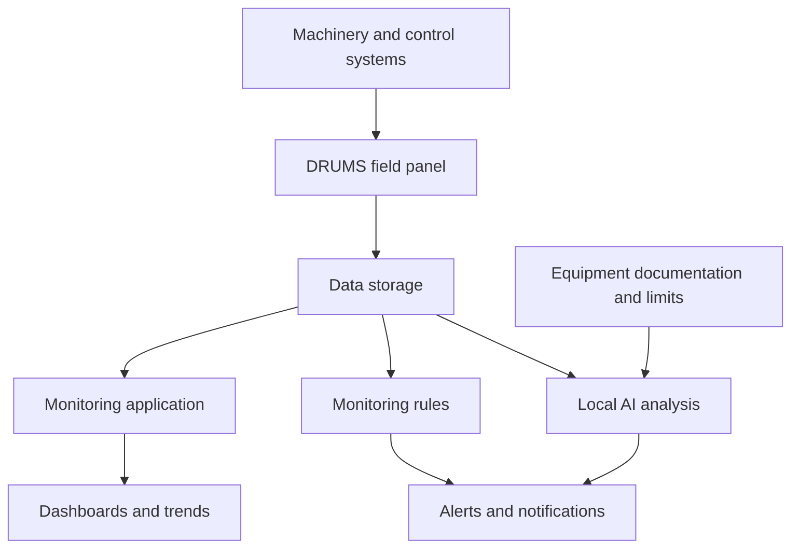

# DRUMS About Page — Content and Implementation Brief

## 1. Task for Codex

Update the existing DRUMS introduction page at `/about` using this brief. Inspect the repository, its instructions, current page, shared components, and available assets before implementing. Work within the existing framework and design system.

Deliver a working page, not just suggested copy. Preserve existing application functionality, routes, authentication, and unrelated pages. Do not publish or deploy unless separately requested. Report changed files, validation results, and any missing assets or unverified capabilities.

The existing website is https://drums.dqtech.cloud/about. This brief was prepared from the supplied screenshot and the owner's description; the complete live page was not retrievable. Inspect the actual implementation rather than assuming its unseen content or layout.

## 2. Objective and Positioning

Present DRUMS as a customizable industrial platform for data collection, storage, visualization, monitoring, and AI-assisted analysis.

Marine installations are the current practical foundation. Keep marine imagery and installation records, while making clear that the platform can be adapted to other machinery and industrial systems.

The central differentiator is Daikai's control over the complete solution: CPU board PCB design and component assembly, field panel engineering and fabrication, data storage, application servers, monitoring software, and local AI integration. This allows customization for a single machine or an entire monitored system.

**Approved key heading:** From Board Design to Intelligent Monitoring

**Core message:** We engineer the complete monitoring solution around your equipment.

**Audience:** Equipment owners, engineering managers, maintenance teams, operators, and technical decision-makers in marine and industrial settings.

**Desired understanding:** DRUMS is a complete platform, the field panel is one part of it, Daikai develops and integrates its major layers, and each installation can be adapted to the equipment's requirements.

## 3. Content and Claim Rules

- Write public-facing copy in English.
- Use the approved wording below, adjusting line breaks and minor grammar where needed for layout.
- Prefer specific capabilities over broad marketing claims.
- Describe CPU board design and assembly accurately. Do not imply that Daikai fabricates semiconductor processors or manufactures every purchased component.
- Preserve DRUMS branding and its established expanded name, if present. Do not invent a new acronym expansion.
- Present marine installations as existing experience. Label non-marine examples as potential applications unless supported by actual projects.
- Do not invent installation numbers, customers, performance metrics, certifications, supported protocols, uptime guarantees, or customer testimonials.
- Check existing evidence before retaining certification or compliance claims. Distinguish a target, submitted application, and achieved certification.
- Local AI may use technical documentation, operating limits, and relevant historical data. Do not describe retrieval or document indexing as model training.
- Claim model training or fine-tuning only if implemented and confirmed. Do not claim validated predictive maintenance, guaranteed fault detection, or remaining-life estimation without evidence.
- If the AI capability is planned or under development, label the relevant public-facing feature accordingly. Do not silently present it as deployed. Use the alternate wording in Section 5F if status cannot be verified.
- Keep rule-based alarms distinct from AI-assisted interpretation. AI supports investigation; do not portray it as autonomously controlling or stopping equipment without confirmed functionality.
- Do not claim that all processing happens on the field panel, that the system is fully offline, or that no data leaves the site unless the actual deployment supports that claim.
- Preserve supported existing security information. Do not add unverified encryption, isolation, or data residency promises.

## 4. Page Structure and Navigation

Recommended sequence:

1. Hero: broader platform positioning.
2. Overview: what DRUMS does.
3. Engineering: complete development capability.
4. Architecture: how equipment data becomes actionable information.
5. Customization: tailored to each machine or system.
6. Intelligent monitoring: rules, local AI, and notifications.
7. Applications: marine experience and industrial adaptability.
8. Gallery and installation records: real evidence.
9. Security: retain accurate existing content.
10. Contact call to action.

Suggested section navigation: Overview · Engineering · How It Works · Customization · Intelligent Monitoring · Installations · Security

Reuse existing anchors where feasible. If renaming an existing anchor, preserve compatibility with current inbound links. Existing gallery and supply records can be incorporated under Installations, provided their information and access remain available.

## 5. Ready-to-Use Website Copy

### A. Hero

Eyebrow: DAIKAI ENGINEERING PTE LTD

H1, displayed across two lines:

> Your equipment data.
> Clearer decisions.

Lead:

> DRUMS is a customizable platform for industrial data collection, storage, visualization, and intelligent monitoring.

Supporting copy:

> Engineered by Daikai—from CPU boards and field panels to server infrastructure, monitoring software, and local AI—DRUMS connects equipment data with the information needed for timely action.

Context line:

> Built on marine experience. Adaptable to industrial machinery and systems.

Primary CTA: Explore DRUMS → overview section.

Secondary CTA: Our Engineering Capabilities → engineering section.

If local AI status is unverified, replace “monitoring software, and local AI” with “monitoring software, with local AI integration tailored to project requirements.”

### B. Overview

Heading: One Platform. From Equipment to Insight.

> DRUMS brings equipment data into one connected monitoring system. It collects operating signals from machinery and existing control systems, stores historical records, and presents information through accessible dashboards.
>
> Configurable alarms and automated notifications help operators recognize abnormal conditions. AI-assisted analysis can add equipment-specific context to support investigation and decision-making.
>
> Today, most DRUMS installations serve marine applications. The same platform can be adapted to monitor individual machines, production equipment, utilities, and other industrial systems.

Five short capability labels:

- Collect — Capture operating data from connected equipment.
- Store — Retain historical data for review and analysis.
- Visualize — View equipment status and operating trends.
- Analyze — Interpret data using monitoring rules and equipment knowledge.
- Notify — Deliver alerts through configured notification channels.

### C. Engineering

Heading: From Board Design to Intelligent Monitoring

> Daikai designs, builds, and integrates the complete DRUMS solution—from CPU board design and component assembly to field panels, data servers, monitoring software, and local AI.
>
> This control over the technology allows us to customize the hardware, interfaces, dashboards, and monitoring logic for each machine or system.

Use six capability cards:

**CPU Board Design & Assembly**

> PCB design and component assembly for the DRUMS CPU board, tailored to the required interfaces and operating environment.

**Field Panel Engineering**

> Panel design, fabrication, wiring, and assembly to connect machinery with reliable field data collection.

**Data & Server Infrastructure**

> Integration of data collection, communications, storage servers, and application servers into a complete monitoring architecture.

**Monitoring Applications**

> Equipment views, dashboards, historical trends, alarm settings, and notification workflows built around operational needs.

**Local AI & Equipment Knowledge**

> Local AI integration using technical documentation, operating limits, and relevant data to support equipment-specific analysis.

**Integration & Commissioning**

> Equipment connection, signal verification, system configuration, and commissioning to deliver a working monitoring solution.

### D. How It Works

Heading: From Equipment Data to Timely Action

> DRUMS connects field equipment with centralized storage and monitoring applications. Operators can review current conditions, explore historical trends, and receive notifications based on configured monitoring logic.

Infographic labels:

- Machinery & Existing Control Systems
- DRUMS Field Panel
- Data Storage
- Monitoring Application
- Dashboards & Trends
- Monitoring Rules
- Local AI Analysis
- Equipment Knowledge
- Alerts & Notifications

Supporting captions:

**At the equipment:** The DRUMS panel connects to the machine or existing control system and collects the required signals.

**At the server:** Data is stored and made available to monitoring applications and analysis services.

**For the operator:** Dashboards, historical trends, and notifications provide visibility into equipment conditions.

### E. Customization

Heading: Built Around the Equipment You Operate

> Every machine has different signals, operating limits, and maintenance requirements. DRUMS can be tailored to an individual asset or a wider monitoring system.

Customization items:

- Equipment interfaces and data acquisition requirements.
- Panel layout, hardware configuration, and installation arrangements.
- Data sampling, storage, and communication settings.
- Dashboards, operating trends, and reporting.
- Alarm thresholds, notification rules, and escalation workflows.
- AI knowledge and analysis for the monitored equipment.

Closing line:

> The solution starts with your equipment and the information your team needs to operate and maintain it.

### F. Intelligent Monitoring

Heading: Equipment Knowledge. More Meaningful Alerts.

Use this copy when local AI functionality is confirmed:

> DRUMS combines configurable monitoring rules with local AI informed by equipment documentation, operating limits, and available historical data.
>
> Threshold alarms identify defined limit violations. AI-assisted analysis adds context by examining relevant operating information and helping explain potential concerns.
>
> Monitoring logic and AI knowledge can be adapted to each machine or system, supporting timely notifications and more informed investigation.

If AI implementation status cannot be verified, use this alternative instead:

> DRUMS provides configurable monitoring rules and automated notifications. Local AI integration can be developed around equipment documentation, operating limits, and relevant historical data to support contextual analysis.
>
> AI functions and their deployment scope are defined for each project and verified against the available equipment data.

Two visual cards:

**Rule-Based Monitoring**

> Defined limits and configured conditions trigger alarms and notifications.

**AI-Assisted Analysis**

> Equipment knowledge and operating data provide context for investigating abnormal conditions.

Illustrative example, visibly labeled “Example workflow”:

> An operating temperature exceeds its configured limit. The monitoring rule raises an alarm. AI-assisted analysis can review relevant trends and equipment documentation to help the operator investigate.

Do not assign a temperature, cause, confidence score, or guaranteed diagnosis without a confirmed equipment example. If this example is not implemented, label it “Illustrative workflow” and keep it separate from actual dashboard screenshots.

### G. Applications

Heading: Marine Experience. Wider Industrial Possibilities.

> Our current installations demonstrate DRUMS in marine operating environments, connecting onboard equipment with centralized data collection and remote monitoring.
>
> This engineering experience provides a foundation for adapting DRUMS to other machinery and industrial systems, with hardware, interfaces, and monitoring functions selected for each application.

Current experience label: Marine Installations

> Explore existing DRUMS installations and the equipment they monitor.

Potential applications label: Adaptable Industrial Applications

- Engines & Generators
- Pumps & Compressors
- Production Machinery
- Utility & Auxiliary Systems

Supporting line:

> Industrial applications are assessed and configured according to equipment interfaces, available signals, and project requirements.

### H. Installation Gallery

Heading: Our Technology in Practice

> Explore the hardware, installation work, and monitoring interfaces behind DRUMS.

Retain genuine existing installation photographs and supply records. Keep verified vessel names, equipment details, and dates. Do not fabricate project descriptions or convert potential applications into installation records.

### I. Closing CTA

Heading: Let's Build the Monitoring System Your Equipment Needs

> Tell us about your machinery, available signals, and monitoring requirements. We can discuss a DRUMS solution tailored to your application.

Primary CTA: Discuss Your Application

Secondary CTA: View Installations

Connect the primary CTA to the website's existing contact method. Do not invent an email address or add a nonfunctional form.

## 6. Architecture Infographic Specification

Build the infographic as responsive HTML/CSS or SVG using the project's existing tools. Use real text, simple icons, and clear connections. Avoid a raster diagram with tiny text or an unnecessary new diagram dependency.

Model these relationships:

1. Machinery and existing control systems send signals to the DRUMS field panel.
2. The field panel sends collected data to server-side storage and the monitoring application, following the actual architecture found in the project.
3. The monitoring application reads stored data for dashboards and historical trends.
4. Monitoring rules evaluate data and generate alerts.
5. Local AI analysis uses relevant operating data and equipment knowledge to support contextual analysis and, where implemented, notifications.
6. Alerts and contextual notifications reach operators through configured channels.

Show the field and server/application areas separately. Do not draw a feedback control connection to the machine unless actual control is supported. The diagram should explain logical functions, not assert that each function requires a separate physical server.

Reference topology (implementation guidance; rendering Mermaid on the public page is optional):

Caption: “Illustrative system architecture. Configuration depends on the equipment and project requirements.”

Adjust the server data flow to match the implemented architecture. If AI remains planned, mark its node and branch “Planned” or “Project-specific” as appropriate.

## 7. Real Photo and Drawing Plan

Use authentic assets already present in the repository wherever possible. Never generate a synthetic photograph and present it as an actual Daikai product or installation.

| Placement | Preferred asset | Caption | Purpose |
| --- | --- | --- | --- |
| Hero | Existing vessel image | Optional marine experience context line | Preserve brand continuity |
| Engineering section | Actual CPU board close-up | Designed at board level | Demonstrate PCB and hardware capability |
| Engineering gallery | Component soldering or bench testing | Assembled and tested by our team | Demonstrate practical development work |
| Engineering gallery | Actual open DRUMS panel | Built for the installation | Show terminals, wiring, CPU board, and power supply |
| How It Works | Custom architecture infographic | From equipment data to timely action | Explain the complete system |
| Customization | Redacted panel drawing or wiring layout | Configured for your equipment | Explain engineering adaptation |
| Installations | Actual onboard panel and machinery | Applied in real operating environments | Demonstrate completed work |
| Monitoring section | Actual dashboard screenshot | Equipment data made visible | Show the real software |
| Intelligent monitoring | Labeled illustrative workflow | Equipment knowledge adds context | Explain AI without implying an unverified deployment |

Photo presentation guidance:

- Use a three-image strip for CPU board, completed panel, and installed system.
- Add assembly/testing and dashboard images in a secondary gallery if available.
- Use consistent image containers, with cropping that preserves important components.
- Use `object-fit: contain` for drawings and dashboards; use intentional crops for installation photographs.
- Keep captions outside images so they remain accessible and readable on mobile.
- Add descriptive alt text based on what is actually visible.
- Avoid exposing credentials, personal information, sensitive network details, or confidential drawing information. Use a sanitized copy while preserving source assets.
- If a required photo is unavailable, use a clean vector illustration or omit that optional image. Do not show broken images, fake product photos, or public-facing “TODO” placeholders.
- Document missing photo opportunities in the implementation handoff.

Suggested logical asset names, not claims that these files exist:

- `drums-cpu-board.webp`
- `drums-board-assembly.webp`
- `drums-panel-interior.webp`
- `drums-installation.webp`
- `drums-dashboard.webp`
- `drums-panel-drawing.webp`

## 8. Visual Design and Responsive Behavior

- Preserve the current dark navy, cyan, and white identity. Reuse existing design tokens and fonts.
- Keep the vessel hero image with an overlay that makes the broader headline readable.
- Use one H1; use H2 for main sections and H3 for cards where appropriate.
- Make the approved engineering heading a prominent section title, not a small caption.
- Alternate concise copy, diagrams, and real photos. Avoid turning the page into a wall of cards.
- Group the six engineering capabilities into three conceptual pairs: hardware, platform, and intelligence/integration. They may appear in a three-column grid on wide screens and stack on narrow screens.
- Keep the system infographic readable on mobile by stacking its logical groups vertically.
- Avoid horizontal overflow, overlapping navigation, excessive empty space, and text embedded in images.
- Ensure keyboard-visible focus states, adequate contrast, accessible link labels, and touch-friendly controls.
- Respect reduced-motion preferences. Animation should not be necessary to understand the architecture.
- Provide anchor scroll offsets if the navigation is sticky.
- Optimize large images, set dimensions to reduce layout shift, and lazy-load below-the-fold photography.
- Use the existing icon library and components before adding dependencies.

## 9. Metadata

Suggested page title:

> DRUMS | Customizable Industrial Monitoring by Daikai

Suggested meta description:

> Discover DRUMS by Daikai: customizable data collection, storage, visualization, and monitoring, from CPU board design to complete system integration.

Preserve the existing canonical URL, social metadata conventions, and routing strategy. Do not invent structured-data claims or change unrelated site-wide metadata.

## 10. Implementation Workflow

1. Read repository instructions and identify the `/about` implementation, shared styles, navigation, and assets.
2. Inspect existing content so useful features, supply records, security details, and genuine project evidence are retained.
3. Map available images to the photo plan and identify any unsupported claims or missing inputs.
4. Implement the content and responsive layout in the existing stack.
5. Build the architecture infographic using accessible native components or SVG.
6. Wire CTAs and anchor navigation to real destinations.
7. Run the repository's relevant build, lint, and type checks. Fix issues introduced by the change.
8. Inspect desktop and mobile layouts using available preview/browser tooling.
9. Report the changes, checks, missing assets, and any capabilities that require owner confirmation.

## 11. Acceptance Checklist

- [ ] The opening explains DRUMS as an industrial data and monitoring platform.
- [ ] The approved heading appears exactly: “From Board Design to Intelligent Monitoring”.
- [ ] PCB design, component assembly, panels, servers, software, and local AI integration are represented accurately.
- [ ] Customization for individual machines and wider systems is clear.
- [ ] Marine imagery and genuine deployment evidence remain visible.
- [ ] Potential industrial applications are clearly distinguished from completed installations.
- [ ] The architecture shows acquisition, storage, visualization, rules, AI context, and notifications.
- [ ] AI wording matches implementation status and does not confuse document retrieval with training.
- [ ] Rule-based alarms remain distinct from AI-assisted analysis.
- [ ] Existing installation records and accurate security content remain accessible.
- [ ] Real photographs are used where available, with no fabricated deployment imagery.
- [ ] All buttons and anchors work; no broken assets or public placeholders remain.
- [ ] Mobile and desktop layouts are readable and accessible.
- [ ] Relevant repository checks pass, or remaining failures are explained.
- [ ] No unrelated application behavior is changed.

## 12. Suggested Prompt to Accompany This File

> Update my existing DRUMS `/about` page according to this Markdown brief. Inspect the repository and existing assets first, then implement the revised copy, responsive layout, engineering capability section, and architecture infographic using the current technology stack. Keep the existing marine imagery and genuine installation records. Use “From Board Design to Intelligent Monitoring” exactly as the main engineering heading. Distinguish confirmed functions from project-specific or planned AI features. Complete the implementation and relevant checks, then summarize the changes and any missing photo assets. Do not deploy unless I ask.
